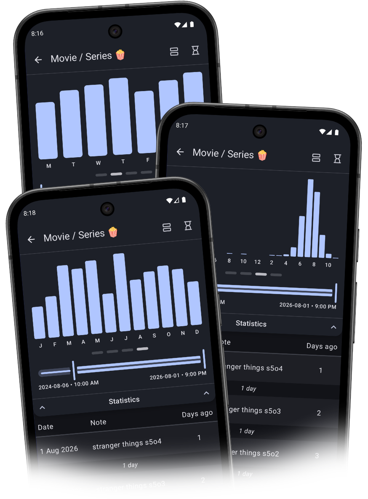
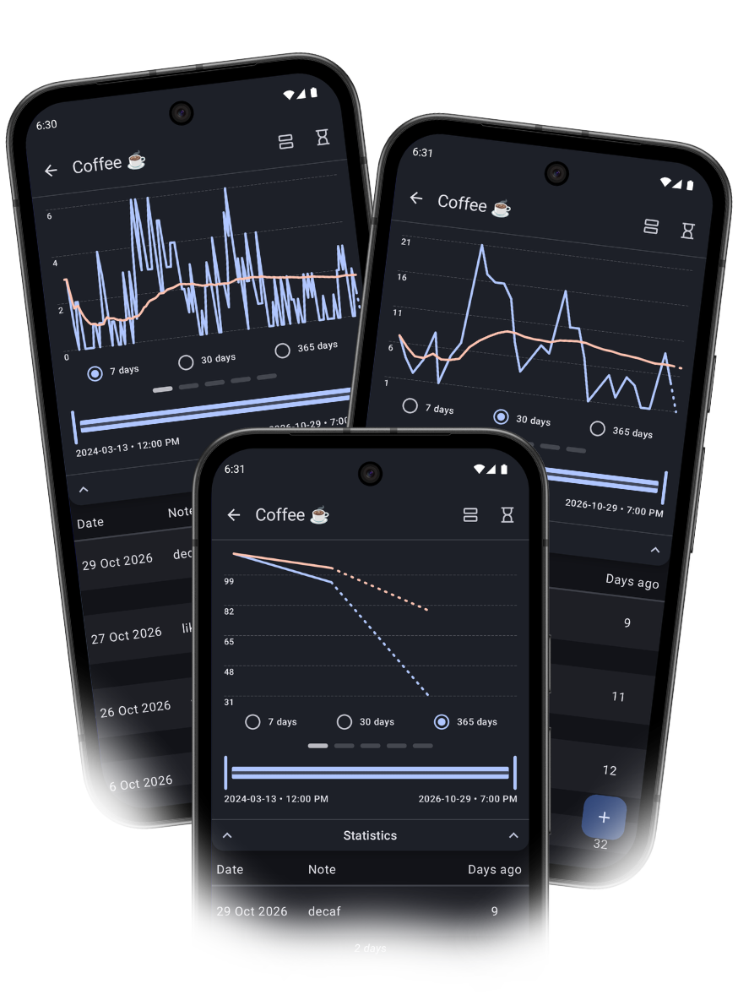

# What’s new in version 1.11

*Published on Google Play: August 3, 2026 (version 1.11.6: November 13)*

    
    

        <h3>Bar Charts 📊</h3>
        
Here they are! Just swipe to see your data turn into bar charts! Three distributions are currently available:

        <ul>
            <li>weekly,</li>
            <li>hourly,</li>
            <li>monthly.</li>
        </ul>
        
Happy exploring!

        
Have an idea for another bar chart? <a href="mailto:mylogger@gfini.com">Let me know!</a>

    

    

        <h3>Line Charts 📈 (since version 1.11.6)</h3>
        
If you swipe in the other direction, you'll see a line chart showing the number of logs in 7-, 30-, or 365-day intervals (your choice!), along with the average number of logs per interval!

        
Sounds complicated, but it's actually very simple. The more zigzaggy line shows the number of logs in each consecutive interval of x days, starting from the date of your first log. The other line represents the average, which is why it becomes smoother over time. 😊

        
The last segment of the chart is dashed because it represents the current, incomplete interval of x days.

    

    

### A Few Other Improvements
- **Feature Improvement** 📲: When reading a note in the “Cards” view, you can start editing it at a specific point — just press and hold!
- **Background Work Improvement** 🔃: Backups to your Google account are now skipped when no new data has been added.
- **More Information** 📄: System logs (in “App Monitor”) now include the size of the Google account backup.
- **Feature Improvement** 🐈‍⬛: I added 4 new recommended loggers and an expandable description for each to make it clear what benefits they provide.

---
#### Previous versions
[v1.5](/en/version/1.5?src=v1.11) • [v1.6](/en/version/1.6?src=v1.11) • [v1.7](/en/version/1.7?src=v1.11) • [v1.8](/en/version/1.8?src=v1.11) • [v1.9](/en/version/1.9?src=v1.11) • [v1.10](/en/version/1.10?src=v1.11)

---
<a href="/en/?src=v1.11">Go to the homepage</a>
