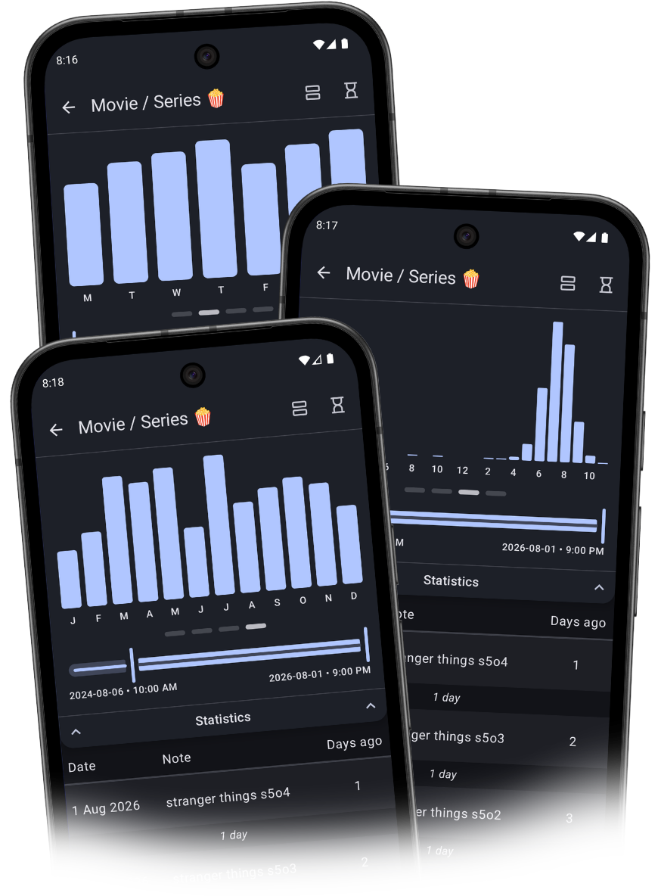

# What’s new in version 1.11

*Published on Google Play: August X, 2026*

    
    

        <h3>Bar Charts 📊</h3>
        
Here they are! Just swipe to see your data turn into bar charts! Three distributions are currently available:

        <ul>
            <li>weekly,</li>
            <li>hourly,</li>
            <li>monthly.</li>
        </ul>
        
Happy exploring!

        
Have an idea for another bar chart? [Let me know!](mailto:mylogger@gfini.com)

    

    

        <h3>Line Charts 📈</h3>
        
<i>Coming soon!</i>

    

    

### A Few Other Improvements
- **Feature Improvement** 📲: When reading a note in the “Cards” view, you can start editing it at a specific point — just press and hold!
- **Background Work Improvement** 🔃: Backups to your Google account are now skipped when no new data has been added.
- **More Information** 📄: System logs (in “App Monitor”) now include the size of the Google account backup.

---
#### Previous versions
[v1.5](/en/version/1.5?src=v1.11) • [v1.6](/en/version/1.6?src=v1.11) • [v1.7](/en/version/1.7?src=v1.11) • [v1.8](/en/version/1.8?src=v1.11) • [v1.9](/en/version/1.9?src=v1.11) • [v1.10](/en/version/1.10?src=v1.11)

---
<a href="/en/?src=v1.11">Go to the homepage</a>
