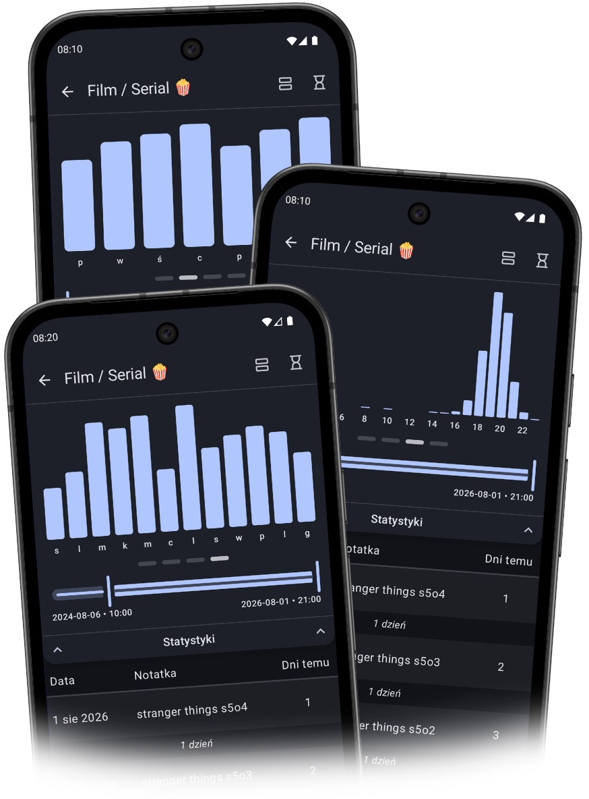
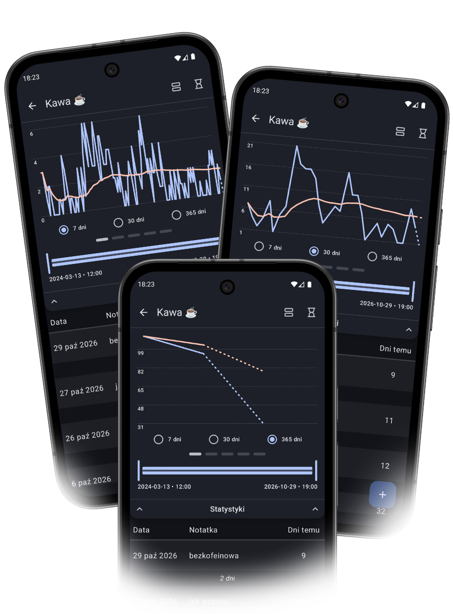

# Co nowego w wersji 1.11

*data publikacji w Sklepie Play: 3 sierpnia 2026 (wersja 1.11.6: 13 listopada)*

    
    

        <h3>Wykresy słupkowe 📊</h3>
        
Oto wjechały! Wystarczy przesunąć palcem, by odkryć, jak Twoje dane zmieniają się w wykresy słupkowe! Obecnie dostępne są 3 rozkłady:

        <ul>
            <li>tygodniowy,</li>
            <li>godzinowy,</li>
            <li>miesięczny.</li>
        </ul>
        
Miłego odkrywania!

        
Masz pomysł na inny wykres słupkowy? <a href="mailto:mylogger@gfini.com">Daj znać!</a>

    

    

        <h3>Wykresy liniowe 📈 (od wersji 1.11.6)</h3>
        
Jeśli zaś przesuniesz palcem w drugą stronę, Twoim oczom ukaże się wykres liniowy liczby logów w blokach 7, 30 lub 365 dni (do wyboru) oraz średniej liczby logów na daną liczbę dni!

        
Brzmi skomplikowanie, ale to bradzo proste. Ta linia bardziej zygzakowata to liczba logów w każdym kolejnym bloku x dni, licząc od dnia pierwszego loga. Druga linia to średnia, dlatego z czasem staje się coraz gładsza. 😊

        
Ostatni segment wykresu jest linią przerywaną, gdyż jest to bieżący, a więc niepełny blok x dni.

    

    

### Parę innych drobnych poprawek
- **Ulepszenie funkcjonalności** 📲: Gdy czytasz notatkę w widoku "Kart", możesz zacząć ją edytować w konkretnym miejscu — wystarczy przytrzymać!
- **Ulepszenie pracy w tle** 🔃: Pomijanie tworzenia kopii zapasowej na koncie Google, gdy nie pojawiły się żadne nowe dane.
- **Zwiększenie informacyjności** 📄: Dodawanie do logów systemowych (w "Monitorze aplikacji") informacji o rozmiarze kopii zapasowej na koncie Google.
- **Ulepszenie funkcji** 🐈‍⬛: Dodałem 4 nowe polecane loggery oraz rozwijany opis do każdego, żeby było jasne, jakie dają korzyści.

---
#### Poprzednie wersje
[v1.5](/version/1.5?src=v1.11) • [v1.6](/version/1.6?src=v1.11) • [v1.7](/version/1.7?src=v1.11) • [v1.8](/version/1.8?src=v1.11) • [v1.9](/version/1.9?src=v1.11) • [v1.10](/version/1.10?src=v1.11)

---
<a href="/?src=v1.11">Przejdź do strony głównej</a>
